Sim racing hardware, desktop software and audio DSP — designed, built and tested in-house.

**[fenixmotionsystems.com](https://fenixmotionsystems.com)**

---

### Sim racing

| | |
|---|---|
| **[Fenix Racing Suite](https://fenixmotionsystems.com/projects/racing-suite)** | The desktop app for our devices: setup, telemetry and firmware updates in one place. |
| **Fenix hardware** | Wheels, pedals, active belt tensioner and dashboards, with their own firmware and USB IDs. |
| **Fenix Deck** | A programmable macro pad with its own display engine. |

### Software

| | |
|---|---|
| **[Blazer](https://fenixmotionsystems.com/projects/blazer)** | A self-hosted AI agent: chat, coding and research that run on your own machines and models. |
| **[FenixPad](https://fenixmotionsystems.com/projects/fenixpad)** | An editor and office suite with a native feel. |
| **[Fenix Hub](https://fenixmotionsystems.com/projects/fenix-hub)** | Ephemeral, secure clipboard and file sharing across your devices — on your LAN, never in the cloud. |

### Audio

| | |
|---|---|
| **[Fenix Mixer](https://fenixmotionsystems.com/projects/fenix-mixer)** | Virtual audio processing for creators. |

---

Built in Spain · <a href="mailto:contacto@fenixmotionsystems.com">contacto@fenixmotionsystems.com</a>

